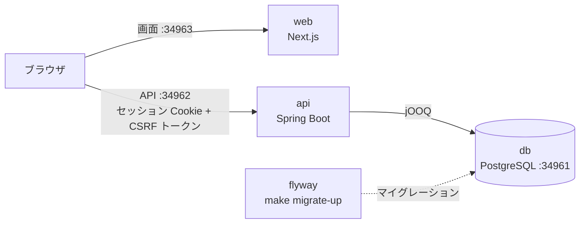
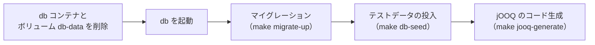

# musiqul

一緒に演奏する仲間を募集・参加できるサービス「musiqul」のモノレポです。

| ディレクトリ | 内容 | 技術 | 詳細 |
|---|---|---|---|
| [`api/`](api/README.md) | バックエンド（REST API） | Kotlin / Spring Boot 4（WebFlux）/ jOOQ | [api/README.md](api/README.md) |
| [`web/`](web/README.md) | フロントエンド | Next.js 16（App Router）/ React 19 / vanilla-extract | [web/README.md](web/README.md) |
| [`db/`](db/README.md) | DB のマイグレーションとテストデータ | PostgreSQL 19 / Flyway 13 | [db/README.md](db/README.md) |

## 全体の構成

`make dev` で起動するコンテナと、その間の通信を示します。web（Next.js）は画面を返すだけで、API の呼び出しはブラウザから api へ直接行います。



- web の proxy は、ログイン時に保存した Cookie の有無だけでログイン済みかどうかを判定します。セッションの検証は api が行います
- flyway はマイグレーションのときだけ動くコンテナです（`make migrate-up` などで起動）

## 必要なもの

- Docker（Docker Compose v2）
- JDK 17 以上（Gradle 9 の実行に必要）：`make jooq-generate`（`make db-reset` に含まれる）と、ホストで api のビルドやテストを実行するときに使います。Gradle が toolchain の JDK 25 を自動でダウンロードします
- Node.js 22.13 以上：ホストで web の lint や E2E テストを実行するときに使います

アプリケーションの実行（api と web）は Docker のコンテナで行うので、JDK と Node.js がなくても動かせます。

## はじめて動かすとき

```shell
make db-reset   # DB を作り、マイグレーション → テストデータ投入 → jOOQ のコード生成
make dev        # db / api / web を起動（Ctrl+C で停止。バックグラウンドで動かすなら make start）
```

jOOQ の生成コード（`api/jooq/generated-src`）は Git で管理していないため、最初に `make db-reset` で生成しないと api がコンパイルできません。

`make db-reset` は次の順に実行します。



> `make db-reset` はボリューム `db-data` を削除するので、ローカルの DB に入っているデータはすべて消えます。残したいデータがあるときは、先に `make db-dump` で保存してください。

起動したら http://localhost:34963 を開き、テスト用のアカウントでログインします。

| メールアドレス | パスワード |
|---|---|
| test@example.com | password123 |

テストデータは `db/seed/` の CSV で管理しています（[db/README.md](db/README.md#テストデータ)）。

## ポート

| サービス | コンテナ名 | URL |
|---|---|---|
| web | `web` | http://localhost:34963 |
| api | `api` | http://localhost:34962 |
| db（PostgreSQL） | `db` | `localhost:34961`（DB：`msqdb`、ユーザー / パスワード：`pgadmin` / `pgadmin`） |

## よく使うコマンド

| コマンド | 内容 |
|---|---|
| `make dev` / `make start` / `make stop` | 全サービスを起動（フォアグラウンド / バックグラウンド）、停止 |
| `make db-reset` | DB を作り直し、マイグレーション・テストデータ投入・jOOQ のコード生成を行う |
| `make migrate-up` / `make migrate-info` | マイグレーションの適用、状態の確認 |
| `make jooq-generate` | DB から jOOQ のコードを生成する（マイグレーションを追加したあとに実行） |
| `make test` | api のテストと web の lint |
| `make lint` | web の lint（ESLint と Steiger） |
| `make help` | すべてのコマンドの一覧 |

## 開発の流れ

- main への直接の push はせず、ブランチを作って Pull Request でマージします
- 依存ライブラリの更新は Dependabot が毎週金曜日に Pull Request を作ります（`.github/dependabot.yml`）
- 今後の課題（CI、デプロイ先、Docker の使い分け）は GitHub の Issue で管理しています

## IDE（IntelliJ IDEA）

リポジトリのルートを開きます。Gradle プロジェクトは `api/` にあり、Project SDK には JDK 25 を設定します（初回のビルドで Gradle がダウンロードした `~/.gradle/jdks` の JDK 25 を選べます）。
