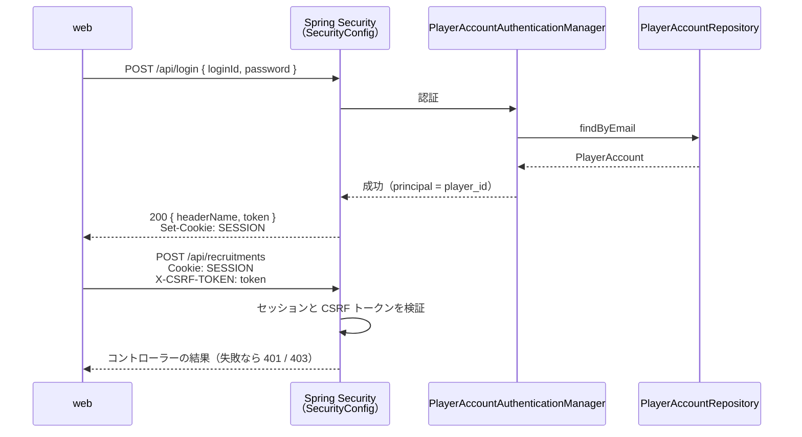
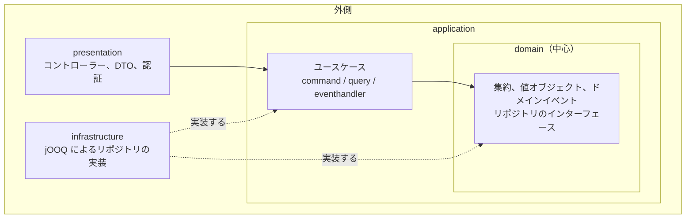
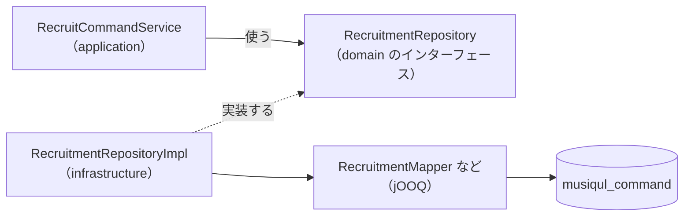
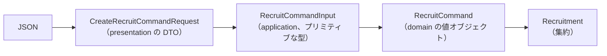
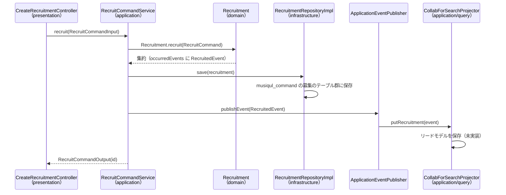
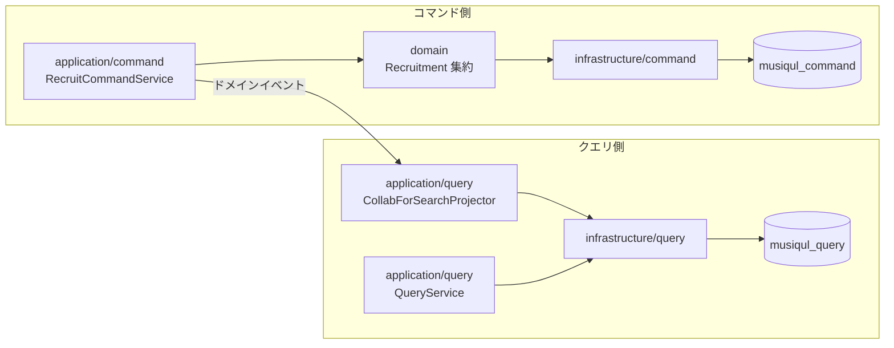
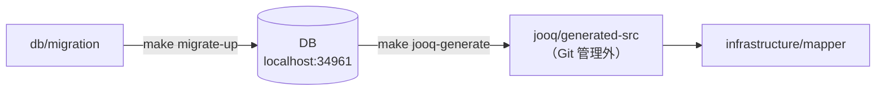

# musiqul-api

musiqul のバックエンドです。Kotlin と Spring Boot（WebFlux）で作っています。構成には、ドメイン駆動設計（DDD）のオニオンアーキテクチャと、コマンドとクエリを分ける CQRS を採用しています。

| 対象 | バージョン |
|---|---|
| Java（toolchain） | 25 |
| Kotlin | 2.4 |
| Spring Boot | 4.2（Spring Framework 7、Spring Security 7、Jackson 3） |
| jOOQ | 3.21（`nu.studer.jooq` プラグインでコード生成） |
| Gradle | 9.9（wrapper） |
| テスト | JUnit 6、mockito-kotlin、Testcontainers 2 |
| フォーマッタ | Spotless + ktlint |

## 起動

通常はリポジトリのルートで `make dev` を実行し、コンテナ（`api`）で起動します（http://localhost:34962）。

ホストで直接起動する場合は、コンテナの api を止めてから、web が呼び出すポート（34962）で起動します。

```shell
docker compose stop api
cd api && SERVER_PORT=34962 ./gradlew bootRun --args='--spring.profiles.active=local'
```

`local` プロファイル（`application-local.properties`）は `localhost:34961` の DB に接続します。コンテナでは `DATASOURCE_URL` などの環境変数で接続先を指定しています（`application.properties`）。

## API

| メソッド | パス | 認証 | 内容 |
|---|---|---|---|
| POST | `/api/login` | 不要 | ログイン。ボディは `{ loginId, password }`（loginId はメールアドレス）。成功するとセッションを作り、CSRF トークン `{ headerName, token }` を返す。失敗は 401 |
| POST | `/api/logout` | 必要 | ログアウト（セッションを破棄） |
| POST | `/api/recruitments` | 必要 | 募集を作成し、`{ id }` を返す。オーナーはログイン中のプレイヤー |

- API のパスは `/api` で始めます
- 未認証のリクエストは 401 を返します
- CORS は web（`http://localhost:34963`）からのリクエストだけを許可しています（`WebConfig`）

### 認証の流れ

認証はセッション（Cookie）で行います。ログインに成功すると、API はセッションを作り、CSRF トークンを返します。以降の状態を変更するリクエストでは、セッション Cookie と CSRF トークンのヘッダーの両方が必要です。



- `/api/login` だけは CSRF トークンなしで受け付けます
- 認証の失敗は、アカウントが存在しない場合も含めてすべて 401 にします。アカウントの有無を外から区別させないためです
- ログインの処理は presentation の `auth` パッケージにあります。application のユースケースを通らず、`PlayerAccountAuthenticationManager` が domain の `PlayerAccountRepository` を直接呼びます

## アーキテクチャ

### レイヤーの依存（オニオンアーキテクチャ）

レイヤーは同心円の形に並びます。中心が domain で、依存は必ず外側から内側に向かいます。domain は他のどのレイヤーにも依存しません。



| レイヤー | パッケージ | 置くもの |
|---|---|---|
| presentation | `msq.musiqulapi.presentation` | コントローラー、リクエストとレスポンスの DTO、認証・セキュリティの設定 |
| application | `msq.musiqulapi.application` | ユースケース。`command` は状態を変更する処理、`query` は参照とリードモデル、`eventhandler` はドメインイベントを受けて行う処理 |
| domain | `msq.musiqulapi.domain` | 集約、値オブジェクト、ドメインイベント、リポジトリのインターフェース |
| infrastructure | `msq.musiqulapi.infrastructure` | リポジトリの実装（jOOQ）、Bean の設定。`command` は集約の保存、`query` はリードモデル、`mapper` はテーブルごとの SQL |
| lib | `msq.musiqulapi.lib` | レイヤーに依存しない汎用の型（`IdFactory`、`NonEmptyMap` など）。どのレイヤーからも使える |

### リポジトリは domain がインターフェースを持つ（依存性の逆転）

infrastructure は外側にありますが、domain から infrastructure を呼んでいるわけではありません。domain がインターフェースだけを持ち、infrastructure がそれを実装します。application はインターフェースだけを知っていて、実装は Spring が注入します。



この形にすると、domain と application は jOOQ やテーブルの構造を知らずに済みます。テストではインターフェースをモックに差し替えられます。

クエリ側も同じ形です。application の `CollabForSearchQueryRepository` と `RecruitmentFindQueryService` はインターフェースで、infrastructure の `query` パッケージが実装します。

### 依存のルール

- **domain は他のレイヤーに依存しない**。リポジトリはインターフェースだけを domain に置き、infrastructure で実装する
- **presentation と application ではプリミティブな型を使い、ドメインの型を外に出さない**。presentation はリクエストを application の Input（`RecruitCommandInput` など）に変換し、application がドメインの値オブジェクトに変換する
- **入力の検証**：Kotlin の非 null 型と jackson-module-kotlin で、必須の項目が欠けたリクエストを受け付けた時点で拒否します。値の制約（文字数の上限など）は domain の値オブジェクトが `init` / `require` で検証します

### 型の変換

リクエストは、レイヤーを 1 つ進むごとに、そのレイヤーの型に変換します。



文字数の上限などの値の制約は、`RecruitCommand` を作るときに値オブジェクト（`SongTitle`、`Memo` など）の `init` で検証します。

## 募集の作成の流れ

`POST /api/recruitments` を例に、リクエストがレイヤーをどう通るかを示します。



1. コントローラーは、募集のオーナーをリクエストのボディではなく、ログイン中のプレイヤー（`principal`）から決めます
2. `Recruitment.recruit` は集約を作り、発生したドメインイベント（`RecruitedEvent`）を `occurredEvents` に持たせます
3. アプリケーションサービスは、集約を保存したあとで `occurredEvents` のイベントを発行します
4. クエリ側のプロジェクター（`CollabForSearchProjector`）がイベントを受けて、リードモデルを更新します

## コマンドとクエリの分離（CQRS）

書き込みと読み取りで、モデルとテーブルを分けています。書き込みは集約を通してコマンド側のテーブルに保存します。読み取りは、画面に合わせた形のリードモデルを使います。リードモデルはドメインイベントから作ります。



- コマンド側のテーブルは `musiqul_command` スキーマ、リードモデルは `musiqul_query` スキーマにあります（マイグレーションは `db/migration`）
- クエリ側は、集約を組み立てずにリードモデルを直接読みます

## jOOQ のコード生成

jOOQ のクラスは、起動中の DB（`localhost:34961`）のスキーマ `musiqul_command` から生成します。

```shell
make jooq-generate   # cd api && ./gradlew generateJooq
```



- 出力先は `jooq/generated-src/jooq/main`、パッケージは `nu.studer.sample` です。Git では管理していません
- マイグレーションを追加・変更したら、`make migrate-up` のあとに実行します（`make db-reset` は生成まで行います）
- 接続先などの設定は `gradle.properties` の `jooq.*` です
- jOOQ のランタイムとコード生成のバージョンは `build.gradle.kts` の `jooqVersion` で揃えています（Spring Boot の BOM のバージョンも上書きしています）

## テストとフォーマット

```shell
./gradlew test            # テスト（MusiqulApiApplicationTests は Testcontainers で PostgreSQL を起動するので Docker が必要）
./gradlew spotlessApply   # ktlint で整形
./gradlew build           # コンパイル、spotlessCheck、テスト
```

- ktlint のルールは `build.gradle.kts` の `spotless` にあります（インデント 2、1 行 100 文字まで）
- `CreateRecruitmentController.kt` は整形の対象外にしています

## 実装中の機能

次の機能は準備だけしてあり、まだ API からは使っていません。

- 募集の編集・締め切り：`Recruitment.edit` / `close`、`EditRecruitmentCommandService`、`RecruitmentRepository.findById`
- 募集一覧のリードモデル：`application/query/colab/collab_for_search`、`infrastructure/query`（保存処理は未実装）
- 募集の詳細の参照：`RecruitmentFindQueryService`
- 募集作成時の X への投稿：`RecruitmentSender`
- プレイヤー：`Player` 集約
