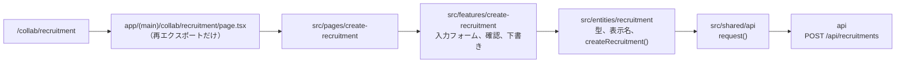
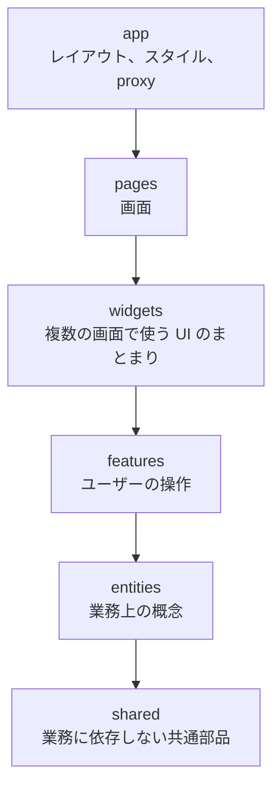
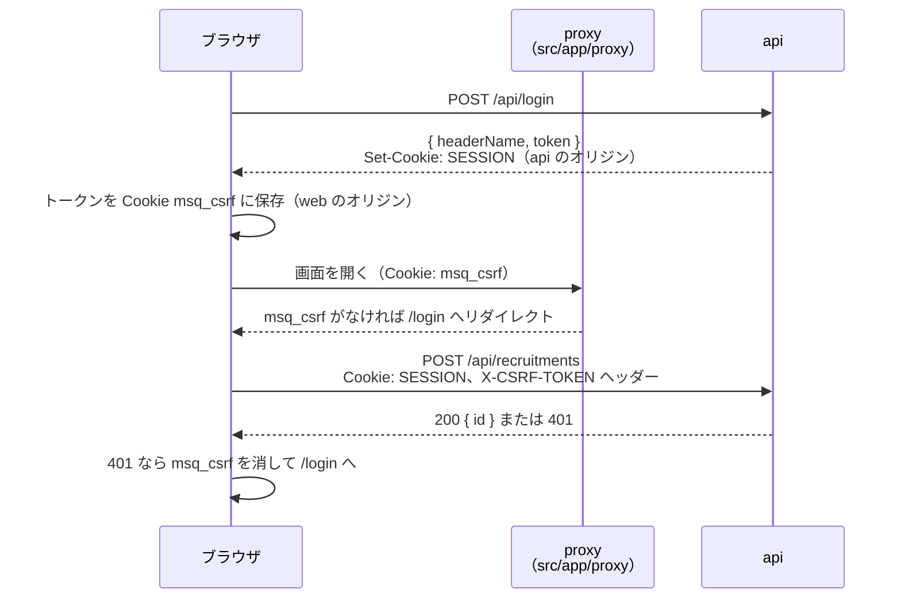

# musiqul-web

musiqul のフロントエンドです。Next.js（App Router）で作り、アーキテクチャには [Feature-Sliced Design（FSD）](https://feature-sliced.design/) を採用しています。

## 起動

リポジトリのルートで `make dev`（docker compose）を実行すると、web・api・db が起動します。web は http://localhost:34963 で開けます。

| コマンド | 内容 |
|---|---|
| `npm run lint` | ESLint と Steiger（FSD のルール検査）を実行する |
| `npm run lint:fsd` | Steiger だけを実行する |
| `npm run build` | 型検査と本番ビルド |
| `npm run storybook` | shared/ui などのコンポーネントを Storybook で確認する |
| `npm run test:e2e` | E2E テスト（`make dev` で起動した環境に対して実行する） |

ログインが必要な E2E テストは、アカウントを環境変数で指定したときだけ実行します。`make db-reset` で投入されるテスト用アカウント（`db/seed/`、一覧は `db/README.md`）を使えます。

```bash
E2E_LOGIN_EMAIL=test@example.com E2E_LOGIN_PASSWORD=password123 npm run test:e2e
```

API の URL は `NEXT_PUBLIC_API_BASE_URL` で変更できます（既定値は `http://localhost:34962`）。

## ディレクトリ構成

```
web/
├── app/            Next.js のルーティング（src/ の pages と app レイヤーを再エクスポートするだけ）
├── pages/          空のまま置く（Next.js が src/pages を Pages Router と見なさないようにするため）
├── proxy.ts        Next.js の proxy（実装は src/app/proxy）
└── src/            FSD のレイヤー
    ├── app/        アプリ全体の設定：レイアウト、グローバルスタイル、proxy
    ├── pages/      画面。1 つの画面でだけ使う部品もここに置く
    ├── widgets/    複数の画面で使う大きな UI のまとまり（サイドメニューなど）
    ├── features/   複数の画面で再利用する、ユーザーの操作（募集の作成など）
    ├── entities/   業務上の概念（募集など）：型、API、表示用の UI
    └── shared/     業務に依存しない共通部品：API クライアント、設定、UI キット、ユーティリティ
```

ルートの `app/` は Next.js のルーティングだけを担当し、画面の実装は `src/` に置きます。たとえば募集の作成画面は、次のようにつながります。



入力フォームは入力画面と確認画面の 2 つで使うので、`pages` ではなく `features` に置いています。入力画面から確認画面へは、sessionStorage に保存した下書きで内容を渡します（`features/create-recruitment/model/draft.ts`）。

現在のスライス：

| レイヤー | スライス | 内容 |
|---|---|---|
| pages | `home` / `login` / `create-recruitment` / `confirm-recruitment` | 各画面。ログインのフォームと API 呼び出しは login 画面でしか使わないので `pages/login` に置いている |
| widgets | `app-sidebar` | ログイン後の画面のサイドメニュー（ログアウトを含む） |
| features | `create-recruitment` | 募集の入力・確認・作成（入力画面と確認画面の 2 つで使う） |
| entities | `recruitment` | 募集の型・列挙値と表示名・作成 API・内容の表示 |
| shared | `api` / `config` / `lib` / `ui` | HTTP クライアントと CSRF トークン、URL と環境変数、日付やフォームの補助関数、UI キットとテーマ |

## ルール

レイヤーは上から下へ並び、import は下向きにだけ行えます。同じレイヤーのスライスどうしも import できません。



上の図では隣のレイヤーだけを矢印でつないでいますが、2 つ以上下のレイヤーを import してもかまいません（例：pages から shared）。

1. **import は上のレイヤーから下のレイヤーへの一方向だけ**：app → pages → widgets → features → entities → shared。同じレイヤーの別スライスも import しない。
2. **スライスの外からは公開 API（`index.ts`）経由で import する**：`@/entities/recruitment` は可、`@/entities/recruitment/model/recruitment` は不可。shared/ui はコンポーネントごとに `@/shared/ui/button` のように import する。
3. **セグメントは役割で分ける**：`ui`（コンポーネントとスタイル）、`model`（型・状態・検証）、`api`（API 呼び出し）、`lib`（スライス内の補助関数）、`config`（設定）。
4. **まずは pages に置く**：1 つの画面でしか使わないものはその画面のスライスに置き、2 か所以上で使うようになった時点で widgets / features / entities に切り出す。
5. **`app/`（ルート直下）にはロジックを書かない**：`export { XxxPage as default, metadata } from "@/pages/xxx"` のような再エクスポートだけにする。例外として、`dynamic`・`revalidate`・`runtime` などの Route Segment Config は Next.js がファイルを静的解析して読むため、`app/` の `page.tsx` / `layout.tsx` に直接書く。
6. **API の仕様は api/（Kotlin）を正とする**：列挙値や文字数の上限は `entities` の model で API のドメインモデルに合わせ、送受信の形式（DTO）は `api` セグメントの中だけで扱う。

1〜4 は Steiger（`npm run lint:fsd`）で検査します。例外は `steiger.config.ts` に理由とともに書きます。

## 技術

- スタイル：vanilla-extract（`*.css.ts`）。色・余白・文字サイズは `@/shared/ui/theme` の `vars` を使い、値を直接書かない。バリエーションのある部品は `@vanilla-extract/recipes` を使う
- フォームの検証：zod。フォームは非制御（`FormData` を読む）にして、送信時に検証する
- API の呼び出し：`@/shared/api` の `request`。セッション Cookie を送り、状態を変更するリクエストには CSRF トークンのヘッダーを自動で付ける

## 認証の流れ



1. `POST /api/login` に成功すると、API がセッションを作り `{ headerName, token }`（CSRF トークン）を返す
2. web はこのトークンを Cookie（`msq_csrf`）に保存し、POST などのリクエストのヘッダーに付ける
3. proxy はこの Cookie の有無でログイン済みかどうかを判定し、未ログインならログイン画面へ移動させる。proxy はセッションの有効性までは確認しない
4. API が 401 を返したら、`request()`（`@/shared/api`）が Cookie を消して `UnauthorizedError` を投げる。ログイン画面への移動は、エラーを受け取った画面側で行う。ログアウト時も Cookie を消す
